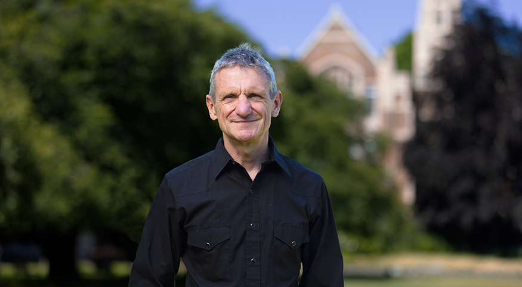
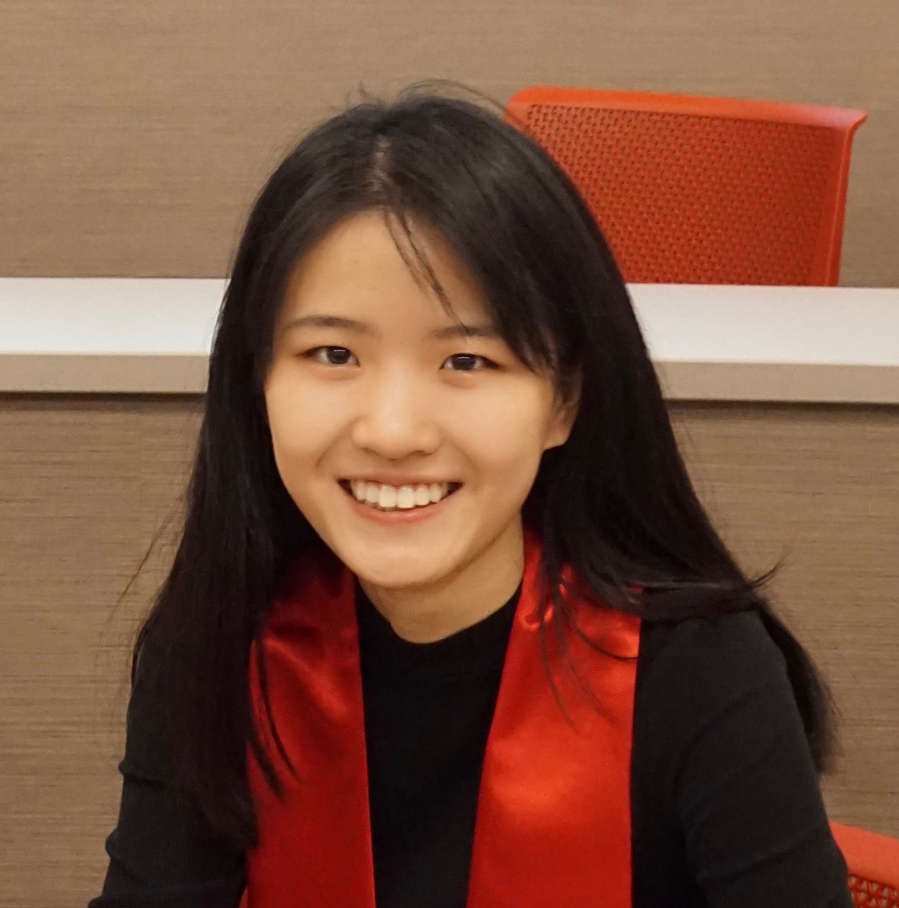
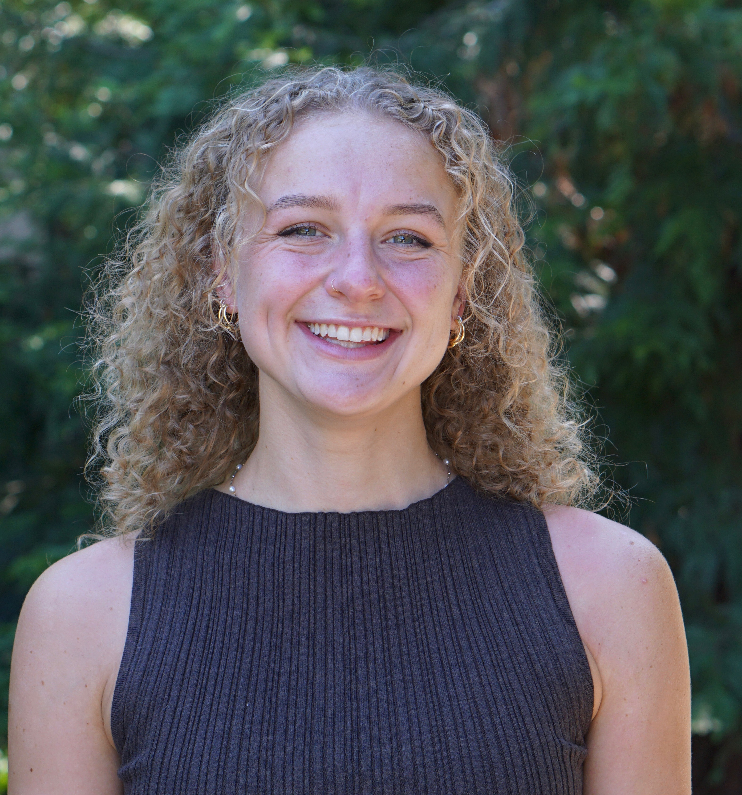

# SAE4Health Core Members

The SAE4Health core team is the group responsible for developing and maintaining the SAE4Health software, including the <a href="https://cran.r-project.org/package=surveyPrev" target="_blank">surveyPrev</a> R package and the R Shiny app, and for advancing the underlying small area estimation methods.

The core team works within a larger network of collaborators in the <a href="https://jonwake.github.io/website/stab/" target="_blank">Space-Time Analysis Bayes (STAB) Research Group</a>, led by Professor <a href="https://faculty.washington.edu/jonno/" target="_blank">Jon Wakefield</a>. STAB is a multidisciplinary group of researchers working on spatial and spatio-temporal methods for health and demographic outcomes in low- and middle-income countries (LMICs), with members based at the University of Washington, the University of British Columbia, the University of California Santa Cruz, and other institutions internationally. Learn more about the STAB group <a href="https://jonwake.github.io/website/stab/" target="_blank">here</a>.

## Principal Investigators

- <a href="https://faculty.washington.edu/jonno/" target="_blank">Jon Wakefield</a> – Professor of Statistics and Biostatistics at University of Washington
    <!-- 

        "In my professional life, I’ve tried to develop models that can be useful. This project has been an opportunity to do something really important."
    
 -->
   <!-- { align=left }-->
    <figure markdown="span">
    {width='170' }
    </figure>

- <a href="https://zehangli.com/" target="_blank">Zehang Richard Li</a> – Assistant Professor of Statistics at University of California Santa Cruz
    <figure markdown="span">
    {width='170' }
    </figure>

## Team Members

- <a href="https://victoriaknutson.github.io/" target="_blank">Victoria Knutson</a> – Postdoctoral Scholar at University of Washington
    <figure markdown="span">
    {width='270'}
    </figure>
    

        Lead and coordinates software development and statistical methods. 
    

- <a href="https://qianyu313.github.io/qd33/" target="_blank">Qianyu Dong</a> – PhD Candidate in Statistics at University of California Santa Cruz
    <figure markdown="span">
    {width='150'}
    </figure>
    

        Lead developer for the SurveyPrev R package.
    

- <a href="https://wu-thomas.github.io/" target="_blank">Yunhan Wu</a> – PhD in Biostatistics at University of Washington
    <figure markdown="span">
    {width='150'}
    </figure>
    

        Lead developer for the R Shiny app and the SAE4Health website.
    

- <a target="_blank">Paige Tomer</a> – Graduate Student in Biostatistics at University of Washington
    <figure markdown="span">
    {width='150'}
    </figure>
    

        Analyzing childhood mortality indicators and their spatial variation.
    

- <a target="_blank">Adi Cohen</a> – Graduate Student in Statistics at University of Washington
    <figure markdown="span">
    {width='150'}
    </figure>
    

        Exploring covariate integration in small-area modeling frameworks.
    

- <a href="https://www.linkedin.com/in/zihang-yu-572793292" target="_blank">Zihang Yu</a> – Graduate Student in Biostatistics at University of Washington
    <figure markdown="span">
    {width='140'}
    </figure>
    

        Streamlined analysis pipeline for MICS surveys.
    

